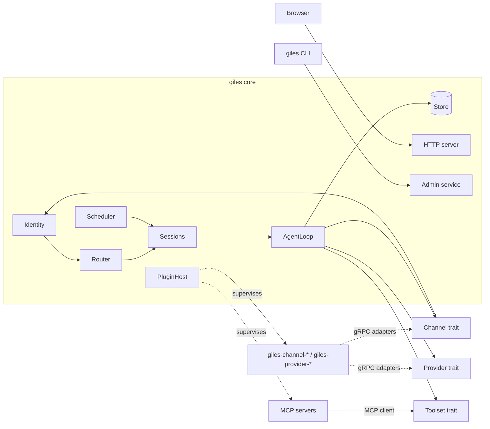
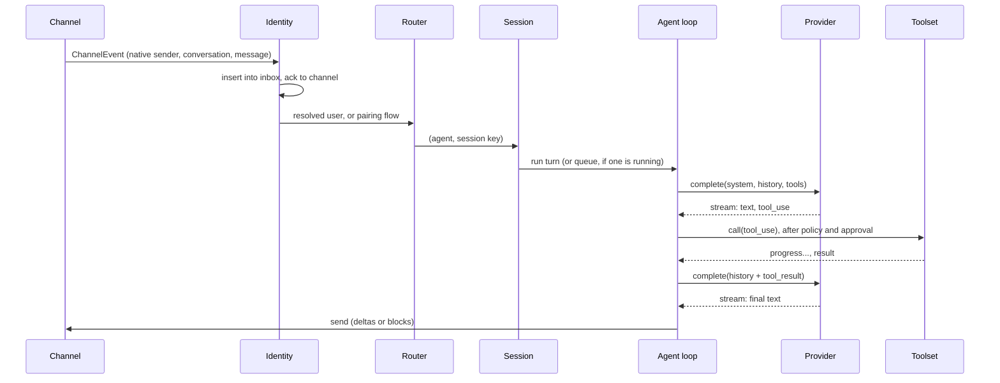

# Giles - Plan

## 1. Overview

`giles` is a long-running daemon. The core does orchestration only: identity, routing, sessions, the
agent loop, scheduling, policy, storage, and supervising plugins. Real work is done by components of
three kinds: providers, channels, and toolsets.

Each component kind is one Rust trait. A component is either built into the core (in-process) or a
plugin (out-of-process, gRPC). The core only ever talks to the trait, so it can't tell which it has.



### 1.1 v1 Scope

v1 is used by one person, the owner, who talks to agents on several channels. Sections describing
several users and group chats are the design for later; v1 builds this subset of them:

- Users: one implicit user, the owner. The owner's identities are declared in `giles.toml`, e.g.
  `[owner] identities = ["whatsapp:+15551234567", "email:me@example.com"]`, with
  `default = "whatsapp:+15551234567"` naming the identity jobs and proactive messages go to. There
  are no user records, roles, pairing, or self-linking (section 3). Messages from any other identity
  are dropped and logged. Sender authenticity (section 3.3) still applies to the owner's identities.
- Group chats: not supported. Channels report the conversation kind, and the core ignores group
  conversations: no turn, no reply, nothing stored.
- Web login: only the `giles admin login-link` one-time URL and the trusted-proxy header.
- Tool approvals: answered by the owner.
- Models: each agent uses the first model in `models`, with no fallback.
- Config: read at startup; changes need a restart. Agent Markdown files are read per turn.

Deferred decisions, each with what v1 does meanwhile and when to revisit it, are in
`Docs/decisions/`: D28, D49, D57, D58, D63, D65, D66.

## 2. Parts of the System

| Part     | What it is                                       | Where it comes from                            |
| -------- | ------------------------------------------------ | ---------------------------------------------- |
| Channel  | A transport users talk through                   | Built-in, or a `giles-channel-<name>` plugin   |
| Provider | An LLM API client                                | Built-in, or a `giles-provider-<name>` plugin  |
| Toolset  | A set of tools and skills from one source        | Built-in (core tools), or an MCP server        |
| Agent    | A personality: config, soul, memory, permissions | Core only (config and storage)                 |
| User     | A person: identity links, role, profile          | Core only                                      |
| Plugin   | Packaging for an out-of-process component        | The core's plugin host                         |

Agents and users are not pluggable. A toolset is an MCP server (section 7.10); one server exposes
many tools from one process.

## 3. Users, Roles, and Identity

### 3.1 Users and Roles

- One operator owns the configuration: agents, providers, channels, plugins, credentials.
- Every person who talks to an agent is a user, with exactly one role. A user is a
  `users/<user>/user.toml` file (section 11.3).
- Roles are defined in config. Each role lists the agents its users may talk to and tool globs they
  may trigger. Giles ships three defaults, which config can change or extend:

  | Role     | Agents             | Tools                     |
  | -------- | ------------------ | ------------------------- |
  | `admin`  | all                | all; may approve pairings |
  | `member` | all                | all the agent allows      |
  | `guest`  | none until granted | core tools only           |

- Agents are global. Per-user data: identity links, profile, per-agent memory, sessions.

A tool call is allowed only if both the agent's allowlist and the role of the turn's requester allow
it. Every turn has exactly one requester (section 6.3).

### 3.2 Identity Links

An identity is (namespace, native identifier), e.g. `whatsapp:+15551234567`, `email:me@example.com`,
or `irc:libera.chat:account:stephen`. The namespace is reported by the channel in its
`ConfigureResponse` (section 8.2), not taken from the instance name, so instances in one namespace
share identities: an address declared once covers every mailbox. The core accepts only a namespace
that starts with the channel component's own name (`irc:` from `giles-channel-irc`), so a plugin
can't claim another channel's identities.

A channel may report other ids for the same sender in `InboundMessage.sender_aliases`; WhatsApp
reports both the phone number and the LID, since group participants usually appear only by LID
([Baileys JIDs](https://baileys.wiki/concepts/jids)). The core keys on the canonical id (`sender`)
and treats a message as from a known identity if the sender or any alias matches.

Identity links map identities to users and live in SQLite. User records and roles live in TOML.
(Multi-user identity storage is deferred: D49.)

Messages from identities with no link never reach an agent. What happens instead is a per-instance
`unknown_senders` policy:

| Policy              | Behavior                                                                  |
| ------------------- | ------------------------------------------------------------------------- |
| `pairing` (default) | Reply once with a one-time pairing code, valid for 1 hour                 |
| `disabled`          | Drop silently (logged)                                                    |
| `open`              | Create a guest user (`users/guest-<id>/user.toml`, role `guest`) and link the identity |

Pairing: an admin approves a code with `giles pair approve <code> --user <user>` or on the web admin
pages, linking the identity to an existing user. `--new-user <user> [--role <role>]` instead creates
`users/<user>/user.toml` (default role `guest`) and links to it. `giles pair deny <code>` rejects
it. Further messages from the same identity while a code is valid don't produce new codes.

Self-linking: a known user sends `/link` on a channel where they're linked and gets a code. Sending
`/link <code>` from the new identity within 10 minutes links it. This works under `pairing` and
`open`, not `disabled`.

Codes (pairing, `/link`, and web login):

- 8 characters from the base32 alphabet (40 bits), stored only as salted hashes.
- At most 3 pending pairing codes per channel instance; at most one new code per sender every 10
  minutes.
- 5 wrong attempts from a sender, or against a code, invalidate the code and lock the sender out for
  an hour.

Core commands (`/new`, `/stop`, `/link`, approval replies) are handled by the core before routing
and never reach an agent.

### 3.3 Sender Authenticity

A channel reports a sender only as an identity it has verified. `InboundMessage` carries
`sender_authenticated`; the core drops unauthenticated messages (logged) before the unknown-sender
policy runs, so a forged sender can't even request a pairing code.

Channels also drop messages that must never start a turn: echoes of the agent's own messages
(WhatsApp delivers copies of messages sent from the linked account) and automated mail
(`Auto-Submitted` other than `no`, `Precedence: bulk` or `list`, `List-Id`). Outbound mail carries
`Auto-Submitted: auto-replied`, per RFC 3834, so other robots don't answer it.

| Channel  | Native identifier          | Verified by                                                     |
| -------- | -------------------------- | --------------------------------------------------------------- |
| Email    | `From:` address            | The topmost `Authentication-Results` header, and only if it carries the configured `authserv-id`, with `dmarc=pass`, or `dkim=pass` aligned with the `From:` domain |
| IRC      | `account:<name>`           | IRCv3 `account-tag` (services account)                          |
| IRC      | `mask:<nick>!<user>@<host>` | Opt-in per instance, for networks without account tags         |
| WhatsApp | Phone number; LID as an alias | The WhatsApp protocol                                        |
| Web      | Login (section 3.4)        | The web login                                                   |

### 3.4 Web Login

- One-time login code: the user enters their user name, Giles sends a code to that user's default
  channel, and entering it sets a session cookie (`HttpOnly`, `SameSite=Lax`, `Secure` when served
  over HTTPS). Web sessions live in SQLite and expire after 30 days.
  - The code is bound to a nonce cookie set in the browser that asked for it; it works nowhere else.
  - Requests are rate-limited per user name and per client address, and the page answers the same
    way whether or not the user name exists.
- Trusted proxy header (Tailscale, oauth2-proxy, Authelia): the header value is treated as a native
  identifier on the web channel instance and linked to a user like any other identity. The header is
  honored only on a dedicated listener the core creates for the proxy: a Unix socket
  (`run/proxy.sock`, mode 0600) or a TCP listener that also requires a shared-secret header the
  proxy adds. Never by source address: any local process, including network-enabled plugins, can
  connect from loopback.
- Bootstrap: `giles admin login-link --user <user>` prints a one-time URL valid for 10 minutes, for
  the first login before any channel is linked.
- Passkeys: later.

## 4. Components and Traits

### 4.1 One Trait, Two Backings

For each kind there is:

1. The trait, used by the core.
2. Native implementations compiled into the core, behind Cargo features.
3. An adapter in the core that implements the trait for an out-of-process component: `Remote*`
   adapters over gRPC for providers and channels, and an MCP client adapter for toolsets
   (section 7.10).
4. A plugin SDK (`giles-plugin-sdk`) that serves a channel implementation as a plugin binary.

v1 doesn't promise that one component can ship either built-in or as a plugin; each component is one
or the other. Provider plugins are deferred: both v1 providers are built in, and Ollama uses the
OpenAI-compatible client. The `Provider` trait stays, so provider plugins can be added later.

### 4.2 v1 Packaging

| Component                             | Packaging                              | Reason                                 |
| ------------------------------------- | -------------------------------------- | -------------------------------------- |
| OpenAI-compatible provider            | Built-in, feature `provider-openai`    | Plain HTTP client                      |
| Anthropic provider                    | Built-in, feature `provider-anthropic` | Plain HTTP client                      |
| Web channel                           | Built-in, feature `channel-web`        | Shares the core HTTP server            |
| Core tools (memory, skills, schedule) | Built-in                               | Operate on core state                  |
| IRC channel                           | `giles-channel-irc`                    | Long-lived connection, crash isolation |
| Email channel                         | `giles-channel-email`                  | Long-lived connection, protocol libs   |
| WhatsApp channel                      | `giles-channel-whatsapp`               | Protocol library, crash isolation      |
| Toolsets                              | MCP servers, one per instance          | Any MCP server works unchanged         |

Built-in components run unsandboxed in the core process. Sandboxing applies to plugins only.

### 4.3 Types

Traits use hand-written domain types from the `giles-types` crate. `prost`-generated types appear
only in `giles-proto`, the `Remote*` adapters, and the plugin SDK, which convert at the gRPC
boundary by moving fields rather than cloning.

Traits are used as `dyn` objects, so async methods go through `#[async_trait]` (one boxed future
per call).

Public enums in `giles-types` and the SDK (`Block`, `CompletionEvent`, `ChannelEvent`,
`ToolCallEvent`, ...) are `#[non_exhaustive]`, so adding a variant isn't a breaking change for
third-party plugin code.

### 4.4 Trait Shapes

```rust
#[async_trait]
pub trait Provider: Send + Sync {
    async fn list_models(&self) -> Result<Vec<ModelInfo>>;
    /// Always streams; callers that want a whole response collect the stream.
    async fn complete(&self, req: CompletionRequest)
        -> Result<BoxStream<'static, Result<CompletionEvent>>>;
}

pub struct CompletionRequest {
    pub model: String,
    pub system: Vec<Block>,
    pub messages: Vec<Message>,
    pub tools: Vec<ToolSpec>, // names already prefixed (section 6.5)
    pub params: GenerationParams,
}

pub enum CompletionEvent {
    BlockStart { index: u32, kind: BlockKind, tool: Option<(String, String)> }, // tool_use id, name
    TextDelta { index: u32, text: String },
    ToolInputDelta { index: u32, partial_json: String },
    ReasoningDelta { index: u32, text: String },
    BlockStop { index: u32, block: Block }, // the complete block, including any Opaque data
    Usage(Usage),
    Stop(StopReason), // EndTurn, ToolUse, MaxTokens, Refusal
}

#[async_trait]
pub trait Channel: Send + Sync {
    fn info(&self) -> &ChannelInfo; // identity namespace, output mode (deltas/blocks), can_initiate
    /// Inbound events: messages and status changes (section 8.5). Every event must be acked once
    /// the core has stored it.
    async fn events(&self) -> Result<BoxStream<'static, Result<ChannelEvent>>>;
    async fn ack(&self, event: &EventId) -> Result<()>;
    async fn send(&self, msg: OutboundMessage) -> Result<MessageId>;
}

#[async_trait]
pub trait Toolset: Send + Sync {
    async fn list_tools(&self) -> Result<Vec<ToolSpec>>; // bare names
    /// Present only for toolsets whose tool list changes at runtime (MCP).
    fn tool_changes(&self) -> Option<BoxStream<'static, Vec<ToolSpec>>> { None }
    async fn list_skills(&self) -> Result<Vec<SkillSummary>>;
    async fn get_skill(&self, name: &str) -> Result<Skill>;
    /// `call.media` carries media the model referenced (section 5).
    async fn call(&self, call: ToolCall, ctx: CallContext) -> Result<ToolCallHandle>;
}

pub struct ToolCallHandle {
    pub events: BoxStream<'static, Result<ToolCallEvent>>, // Progress, ApprovalRequest, Result
    pub answers: mpsc::Sender<ApprovalAnswer>,
}
```

Attachments appear in these types as `MediaRef`, an id in the core's blob store. Moving bytes to and
from plugins is the `Remote*` adapter's job (section 8.3); traits never see it.

Configuration and lifecycle are not on these traits. Built-ins are constructed from config; plugins
get the base service (section 8.2).

### 4.5 How the Parts Interact

One inbound message, end to end. A scheduled job enters at the session step instead of the
channel.



## 5. Message Model

Giles has its own content-block model, patterned on Anthropic's. Each provider implementation
translates it to and from its wire format; the core never sees wire formats.

```rust
pub struct Message { pub role: Role, pub content: Vec<Block>, pub meta: MessageMeta }
pub enum Role { User, Assistant } // the system prompt is assembled per turn, never stored

pub enum Block {
    Text { text: String },
    Image { media: MediaRef },
    Audio { media: MediaRef },
    Document { media: MediaRef, name: Option<String> },
    ToolUse { id: String, name: String, input: serde_json::Value },
    ToolResult { tool_use_id: String, content: Vec<Block>, is_error: bool },
    Reasoning { text: Option<String>, opaque: Option<Opaque> },
    /// A provider-private block (server-side tool blocks, citations) that must be sent back
    /// unchanged. The core stores it and never interprets it.
    Opaque(Opaque),
}

/// Provider data the core stores but never interprets, e.g. Anthropic thinking signatures.
pub struct Opaque { pub api: String, pub data: serde_json::Value }

pub struct MessageMeta {
    pub provider: Option<String>, // assistant messages only
    pub model: Option<String>,    // assistant messages only
    pub usage: Option<Usage>,
    pub at: Timestamp,
    pub sender: Option<UserId>,
}
```

Why not Chat Completions as the canonical model: Anthropic requires thinking blocks (with
signatures) from the latest assistant turn to be sent back unchanged during a tool-use loop, and
tool results may contain images. Chat Completions can hold neither. The OpenAI-compatible provider
moves tool-result images into a following `user` message.

Rules:

- `Opaque` data is sent only to a provider of the same API family. After a fallback to a different
  family (section 6.10) it's dropped from the history sent; the stored transcript keeps it. How
  `Opaque` is matched and when fallback happens: _Deferred, D63_.
- Each inbound message is stored as its own `User` message with its own `MessageMeta`. Provider
  adapters merge consecutive `User` messages when an API requires alternating roles.
- In group sessions, the core renders `MessageMeta.sender` as a prefix on user text
  (`[alice] hello`) for every provider. Anthropic has no speaker field, and one rule keeps
  transcripts provider-independent.
- Channels never see model messages. They exchange their own types, which the core converts:

  ```rust
  pub struct InboundMessage {
      pub conversation: ConversationRef, pub sender: NativeId, pub sender_authenticated: bool,
      pub text: String, pub attachments: Vec<MediaRef>, pub message_id: Option<MessageId>,
      pub reply_to: Option<MessageId>,
  }
  pub struct OutboundMessage {
      pub target: SendTarget, // Conversation(ConversationId) or Recipient(NativeId), section 8.5
      pub markdown: String,   // CommonMark
      pub attachments: Vec<MediaRef>, pub reply_to: Option<MessageId>,
  }
  ```

  An `InboundMessage` becomes a `User` message (`Text` plus `Image`/`Audio`/`Document` blocks).
  An assistant turn's `Text` blocks become `OutboundMessage`s.

Media:

- Each attachment is shown to the model with a reference, e.g. `[media:a3f9 voice.ogg audio/ogg]`.
- A tool input may refer to an attachment as `{"$media": "a3f9"}`. Before the call, the core
  hands the file to the MCP server (section 7.10).
- The core tool `send_attachment(media, caption?)` sends a stored attachment, or media a tool
  returned, to the current conversation.
- Providers declare the media types they accept. Anything else reaches the model only as its text
  reference, so an unsupported type can't make every later request fail.

## 6. Agent Runtime

### 6.1 Routing

Ordered rules in config, first match wins. A rule matches any of channel instance, conversation
kind (`direct`/`group`), user, and conversation id, and names an agent. Most setups are one rule per
channel instance.

```toml
[[routes]]
channel = "irc-libera"
conversation = "#giles"
agent = "jeeves"

[[routes]]
channel = "whatsapp"
agent = "jeeves"
```

In-message addressing (`@name`) is not in v1.

### 6.2 Sessions

Every conversation is its own session, DMs included. The session key is (agent, channel instance,
conversation id): each WhatsApp chat, email thread, IRC query, and web chat has its own history.

- Knowledge crosses channels through memory, not history: the user's per-agent memory is loaded in
  every one of their DM sessions, and `memory_search` covers their transcripts on all channels.
- A turn replies into its own session's conversation.
- Jobs with `session = "dm"` run in the DM conversation on the delivery user's default identity
  (section 6.11).
- `/new` ends the current session and starts a fresh one for later messages. The old session stays
  in SQLite.
- Optional idle reset per agent does the same automatically after a quiet period.

### 6.3 Turns

- At most one turn runs per session.
- Every turn has exactly one requester: the sender of the message that started it, or the creator
  of a runtime job. Config jobs (`agent.toml`) have no requester. The requester decides which tools
  are allowed (section 6.4) and who may answer approvals.
- Inbound messages are rows in the `inbox` table (section 11.4) from the moment they are acked.
  A message that arrives while a turn runs stays `queued` there, so a restart loses nothing.
  Messages from someone other than the requester never join that turn; they start their own turn
  later. Consecutive messages from one person may form one turn. Job prompts never merge into user
  messages.
- New messages from the requester during a turn follow the agent's `busy_mode`:
  - `steer` (default): at each tool-batch boundary, the requester's new messages are appended as
    separate `User` messages after the tool results, so the model sees them mid-turn. Calls in the
    batch that haven't started get the synthetic result "Skipped to read a new message".
  - `queue`: they wait in the inbox and start the next turn.
- `/stop` cancels the running turn. The cancellation reaches plugins and MCP servers, and every
  unanswered `ToolUse` gets the result `cancelled`.
- Each turn is a loop: call the provider, run requested tools, repeat until the model stops without
  asking for a tool or the turn hits its iteration cap.
- Iteration caps: interactive turns have none by default (`/stop` is the brake); job turns stop at
  25. Agents can set `max_iterations` (interactive) and `max_iterations_jobs`. When a cap is hit,
  unanswered calls get the result `iteration limit`, and the core makes one last request with no
  tools offered, so the model tells the user where it stopped. A turn never stops silently.
- Tool calls run in the order the model gave them. Consecutive parallel-safe calls run together, up
  to 8 at once; any other call is a barrier that waits for everything before it and runs alone.
  Parallel-safe means the read-only core tools (`memory_search`, `load_skill`) and every tool of a
  toolset instance marked `parallel = true` (section 7.10).
- Every tool call has a deadline, configurable per toolset instance. When the core drops a call, the
  gRPC cancellation reaches the plugin.

Transcript invariant: every `ToolUse` has a `ToolResult`, because every provider rejects a history
that breaks this.

- An assistant message with N `ToolUse` blocks is stored together with N result slots, in one
  transaction.
- A slot is filled by the tool's result. If the turn ends any other way, the slot gets a synthetic
  error result: `cancelled`, `denied`, `skipped`, `iteration limit`, `interrupted`, or
  `truncated` (a `ToolUse` cut off by `Stop(MaxTokens)`).
- At startup the core fills every empty slot with `interrupted`, marks the inbox rows of turns that
  were running as `unknown`, and tells each requester "Interrupted by a restart; resend if needed."
  Nothing is replayed, so a tool with side effects never runs twice.

### 6.4 Tool Policy and Approvals

A tool may run only if both of these allow it:

- The agent's allowlist: globs over prefixed tool names, e.g. `["github__*", "memory*"]`.
- The requester's role (section 3.1). Runtime jobs run with their creator's role, so `schedule`
  can't be used to reach tools the creator may not call. Config jobs, written by the operator, use
  the agent's allowlist alone.

The tools offered to the model are fixed for the session, so the cached prompt prefix stays valid
(section 6.7): in a DM, the allowlist filtered by that user's role at session start; in a group, the
agent's allowlist. The requester's role is enforced again when a tool is called, and a forbidden
call gets the error result "not permitted for <user>". In v1, with no roles, the session's tools are
the agent's allowlist.

The session keeps its tool list even when a toolset's tools change: a toolset that goes down
(section 7.6) or drops a tool on `list_changed` (section 7.9) leaves the list as it was. A call to a
tool that is no longer served gets the error result "tool unavailable". New sessions get the
current list.

Approval: an agent's `ask` globs list tools that need approval before each call (empty by default).
An MCP server may also ask mid-call through elicitation (section 7.10); the core handles it the same
way.

- Who answers: the user whose message started the turn, or any admin.
- Unattended runs (jobs): a tool matching `ask` returns "denied (unattended)", unless the job sets
  `ask_to = "deliver_to"`; then the delivery user is asked, if their role allows the tool.
- How: the core sends a prompt with a short code, e.g. "Allow `shell__exec` (`rm -rf ./build`)?
  Reply `yes 4821` or `no 4821`." `yes! 4821` also allows that tool for the rest of the session. The
  web channel shows buttons instead. Approval replies are consumed by the core, not queued as
  messages.
- The tool input in the prompt can't change what the prompt says: it's shown in a code span or fence
  longer than its longest run of backticks, with control characters and line breaks escaped. Long
  input is cut, with its size and a SHA-256 prefix shown.
- Denied: the tool receives an error result saying it was denied.
- Waiting: a pending approval waits in memory, the same way for `ask` approvals and for MCP
  elicitation. It expires after the agent's `approval_timeout` (default 10 minutes) and is then
  denied; an expired prompt can't be answered, so the user asks again. A restart denies every
  pending approval (the startup recovery in section 6.3 fills its slot with `interrupted`).
- A new message from the requesting user that isn't an approval reply denies the pending request.
  The tool result reads "Not approved. The user said: ...", and the turn continues with that
  message visible to the model. Messages from other people wait in the inbox for their own turns.

### 6.5 Tool Names

- Plugin tools are always `<instance>__<tool>`. The plugin reports bare names; the core adds the
  prefix.
- The instance name is the prefix: `[toolset.github]` gives `github__create_issue`. For channel and
  provider plugins it defaults to the plugin's `<name>`; config can define several instances of one
  plugin with their own names (`irc-libera`, `irc-oftc`).
- Instance names match `[a-zA-Z0-9-]+`, so they never contain `__`. A prefixed name longer than 64
  characters is rejected when the tool list is loaded.
- Core tools (`memory`, `memory_search`, `load_skill`, `schedule`, `send_attachment`) use bare,
  reserved names. They can't collide with plugin tools.
- Tools and skills are always listed in sorted order, so the prompt prefix is stable for caching.

### 6.6 Skills

The Agent Skills format: a directory with `SKILL.md` (YAML front-matter `name` and `description`, a
Markdown body) and optional resource files.

- Sources: skill directories a toolset instance lists (section 7.10), `<root>/skills/`, and
  `agents/<agent>/skills/`.
- Plugin skills are named `<instance>__<skill>` like tools. Local skills are bare; an agent's skill
  overrides a global one with the same name.
- Each skill's name and description go into the system prompt. The model loads the body with the
  core tool `load_skill(name)`.
- Scripts a skill references are never run by the core; they work only through an execution tool
  plugin. Plugins never read `GILES_HOME`; when a call needs a skill's files, the core hands them
  over like any other media (section 7.10).

### 6.7 Prompt and Memory

The prompt is laid out so provider prompt caching hits on almost every turn. Anthropic caches the
prefix in the order tools, then system, then messages, and a change at one level invalidates
everything after it
([Anthropic prompt caching](https://docs.anthropic.com/en/docs/build-with-claude/prompt-caching)).

- Tools: fixed for the session and sorted (sections 6.4, 6.5).
- `system`, assembled at session start and again after compaction (section 6.8), never per turn:
  1. `SOUL.md`
  2. Skill names and descriptions
  3. The memory snapshot: agent-wide `MEMORY.md`, then per-conversation memory. In a DM, the
     user's `USER.md` and `agents/<agent>/users/<user>/MEMORY.md`. In a group, the group's own
     `MEMORY.md`; participants' `USER.md` and private memory are never loaded in a group, so the
     agent can't repeat them to others there.
- Messages: each stored user message carries a prefix with the time it was sent, in the user's
  timezone (DM) or the agent's (group), next to the `[sender]` prefix in groups. The current time
  never goes in `system`.
- The Anthropic provider uses automatic caching plus one breakpoint at the end of `system`, with a
  1-hour cache TTL for human-paced sessions and 5 minutes for job runs.
- A snapshot test of the rendered `system` and tool list catches changes to the prefix (section
  14.1), and `giles usage` shows the cache hit rate (section 11.7).

Memory is Markdown, one file per scope. The scopes are `agent`, `user` (DMs only), and `group`
(groups only); in v1 only `agent` and the owner's `user` scope are used.

- Snapshot: memory is copied into `system` at session start and refreshed after compaction. Writes
  during a session show in the tool result, not in the prompt, so other running sessions see a new
  fact only after they compact or start anew.
- Tool: `memory(scope, operations[])`. Operations are `add`, `patch{old_text, content}` (replace a
  unique span inside one entry), and `remove{old_text}`. Entries are separated by a `§` line.
  There is no read action, since memory is in the prompt, and no whole-entry replace, which models
  use as find-and-swap and wipe the other facts in an entry (Hermes removed it for that reason:
  [Hermes memory](https://hermes-agent.nousresearch.com/docs/user-guide/features/memory)).
- Caps: each memory file the agent writes has a character cap (`memory_cap`, default 2,200 per
  scope, per agent). The prompt shows a usage header such as `[67% — 1,474/2,200]`. The cap is
  checked on the result of the whole batch; a batch that would exceed it fails and returns the
  current entries and the overflow, so the model can consolidate in the next batch. Text a person
  wrote is never truncated; an over-cap file makes model writes fail until someone consolidates.
- Writes: a per-file lock in the core plus write-to-temp-then-rename, so concurrent sessions don't
  lose each other's writes.
- Search: `memory_search` is FTS5 over transcripts only, kept current by triggers on `messages`.
  It's scoped to the current context: in a DM, that user's DM sessions with this agent; in a group,
  that group's transcript. Memory files aren't indexed; they're already in the prompt. Embedding
  search is not in v1.

Writes to agent-wide `MEMORY.md` are accepted only in turns whose requester is the agent's `owner`
or an admin, and in config job turns, since the operator wrote those jobs. Agent-wide memory is
loaded into every prompt, including the owner's tool-enabled DMs, so a guest or a group must not be
able to plant instructions there.

`USER.md` is written by people only and loaded only in that user's DMs. What an agent learns about a
user goes into that agent's per-user memory.

### 6.8 Context Overflow

When a session's prompt approaches the model's context limit, the core summarizes older history
into a summary record. The prompt then uses the summary plus recent messages. Original messages
stay in SQLite. Starting a new session after an idle period is an opt-in setting per agent. The
summary is written by the agent's `compaction_model` (section 6.10).

### 6.9 Output

The model writes Markdown, and channels receive it as CommonMark. Each channel renders it into its
own format (section 10). Providers always stream. Each channel declares an output mode in
`ChannelInfo`:

- `deltas`: the channel streams live output. In v1 only the built-in web channel does; plugin
  channels showing live output by editing a sent message is deferred.
- `blocks`: the core sends whole chunks, flushed at paragraph boundaries outside code fences and at
  the end of the message.

Reasoning and tool blocks never reach channels.

### 6.10 Models and Fallback

An agent lists models in order as `<provider instance>/<model id>` (split at the first `/`):

```toml
models = ["anthropic/claude-sonnet-4-5", "openrouter/anthropic/claude-sonnet-4.5"]
compaction_model = "ollama/qwen3:8b"   # optional; defaults to models
# Jobs can pick their own model (section 6.11).
```

Fallback rules are reopened (_Deferred, D63_). Current design:

- Each request uses the first model. On a retryable error (rate limit, overloaded, 5xx, timeout) it
  retries that request on the next model. The next request starts from the first again.
- Falling back to a different API family drops `Opaque` reasoning data from the history sent.
- Fallbacks are logged and recorded in usage (section 11.7).

### 6.11 Scheduling

There is one scheduler and one kind of job. A periodic check-in (what other agents call a heartbeat)
is just a job.

```toml
[[jobs]]
id = "check-in"               # stable id, used by `job_runs`
cron = "*/30 * * * *"
session = "isolated"          # isolated (default) | dm
idle_only = true              # wait while a turn runs in the user's DM
active_hours = "08:00-22:00"  # in the job's timezone
model = "ollama/qwen3:8b"     # optional; defaults to the agent's models
prompt_file = "check-in.md"   # relative to agents/<agent>/; or prompt = "..."
deliver_to = "stephen"
ask_to = "deliver_to"         # optional; without it, `ask` tools are denied (section 6.4)
```

- Config jobs live in `agent.toml`. Runtime jobs come from the core tool `schedule`, which lets the
  agent create, list, and cancel jobs for the requesting user ("remind me at 5"). Runtime jobs live
  in SQLite, record their creator, run with the creator's role (section 6.4), and deliver to that
  user. `schedule list` also shows config jobs, read-only.
- `session = "isolated"` starts each run with a fresh context: the delivery user's memory snapshot
  and, optionally (`dm_excerpt = N`), the last N messages of the DM on their default identity.
  `session = "dm"` runs in that DM's session as its own queued turn, never merged into user
  messages.
- Output: a reply of exactly `NO_REPLY` sends nothing and stores nothing. Anything else is delivered
  to the user's default identity and appended to that DM's session as an assistant message, so a
  reply to it has context.
- Each job's last run time is kept in the `job_runs` table, keyed by the job's `id`. Missed runs
  while the core was down are coalesced into one run at startup.
- Timezone: the job's user, else the agent's `timezone`, else the system timezone.

Every proactive send (job output, approval prompts, login codes) goes through the `outbox` table
(section 11.4). It's retried with backoff until the channel accepts it, so output from a job that
fires before WhatsApp or IMAP have reconnected isn't lost. Each row expires: approval prompts and
login codes when the approval or code does, everything else after 24 hours. An expired row is
dropped and logged with its instance, recipient, and kind. Proactive sends are addressed to an
identity, not a conversation (section 8.5).

## 7. Plugins

### 7.1 Kinds and Naming

| Kind       | What it is                                                     | Protocol                 |
| ---------- | -------------------------------------------------------------- | ------------------------ |
| `provider` | `giles-provider-<name>` binary                                  | gRPC `ProviderService`   |
| `channel`  | `giles-channel-<name>` binary                                   | gRPC `ChannelService`    |
| `toolset`  | Any MCP server: a stdio command or an HTTP URL                  | MCP (section 7.10)       |

First-party toolsets are MCP servers named `giles-toolset-<name>`.

For gRPC plugins, the core checks that the kind in `Describe` matches the `<type>` in the binary
name, and refuses the plugin otherwise.

### 7.2 Instances

One process per configured instance. Two IRC networks are two `giles-channel-irc` processes, each
with its own config and sandbox grants. RPCs carry no instance id. Instance config is described in
section 11.2.

Instance names are permanent ids: sessions, the inbox, memory paths, and the plugin's data directory
are keyed by them. Renaming one in `giles.toml` alone would orphan all of that, so
`giles instance rename <old> <new>` does it, with the core stopped: it migrates the database rows,
renames the directories, and renames the `[<kind>.<old>]` table in `giles.toml`. At startup, the
core refuses to start a new instance whose name doesn't match any known data while an unused old
name has data, and points to the rename command.

### 7.3 Discovery and Enablement

The core looks for `giles-<type>-<name>` in `<root>/plugins/`, then on `$PATH`. Only configured
instances run; installing a binary does nothing by itself. A future registry installs into
`<root>/plugins/`.

### 7.4 Launch

This section covers gRPC plugins (providers and channels). Stdio MCP servers launch through the same
trampoline and sandbox, but their transport is the stdin/stdout pipe pair, which is just as private
as a socket pair; MCP's `initialize` exchange is the handshake, and there's no fd 3, token, or
handshake line (section 7.10).

The plugin never creates or listens on a socket. The core hands it one end of a connected socket
pair, so no other process can reach it.

1. The core creates a Unix `socketpair` and spawns the plugin through the sandbox trampoline
   (section 12) with:
   - fd 3: the plugin's end of the pair.
   - stdin: a pipe the core keeps open. The core writes one line, a random per-launch token, and
     nothing more.
   - A scrubbed environment:
     - `GILES_PLUGIN_MAGIC`: a fixed cookie. Run by hand without it, a plugin prints that it's a
       Giles plugin and exits. A usability check, not security.
     - `GILES_PLUGIN_PROTOCOLS`: the major plugin protocol versions the core speaks, e.g. `1`.
     - `GILES_PLUGIN_DATA`: the instance's data directory (section 11.6).
     - `TMPDIR`: a private temp directory inside the data directory.
2. The plugin reads the token, serves gRPC on fd 3, and prints one line to stdout with go-plugin's
   field layout: `1|<protocol>|fd|3|grpc`. That's the handshake version, the protocol major it
   chose, the transport, the address, and the wire protocol.
3. The core checks the line, calls `Describe` over its end of the pair, checks the kind, calls
   `Configure`, and registers the `Remote*` adapter.
4. Every RPC carries the token as `authorization: Bearer <token>` metadata, and the SDK rejects
   calls without it. With a private socket pair this is a second layer, not the main one.
5. All RPCs share the one HTTP/2 connection. If it breaks, the core restarts the plugin; there is no
   reconnect.

`tonic` serves on the one pre-connected stream (`serve_with_incoming_shutdown` with a one-item
stream that then stays pending) and the core connects over it with a one-shot connector; the
transport spike confirmed this, with 16 MiB limits and the bearer token. See
[Plugin Transport](technical/plugin-transport.md) for the exact setup and its caveats.

Because plugins never need to create Unix sockets, seccomp denies `socket(AF_UNIX, ...)` to every
plugin without an explicit grant (section 12). On every supported kernel that closes the paths a
sandboxed plugin could otherwise use: the admin socket, other plugins, D-Bus, systemd-resolved,
`docker.sock`, and SSH or GPG agent sockets. Landlock can only restrict connecting to Unix sockets
from kernel 7.1 (ABI 9).

After the handshake line, stdout is drained and ignored. Stderr is captured line by line into the
core log under the instance's span. `giles-plugin-sdk` does the plugin side of all this.

Failures:

- No line within 10 seconds, a malformed line, or an exit before the line: the launch fails, the
  plugin's stderr is logged, and the restart backoff (section 7.5) applies.
- No shared protocol version: the plugin writes an error to stderr and exits. The core logs it and
  doesn't retry until the binary's hash changes.

Orphaned plugins: if the core dies without stopping its plugins (SIGKILL, crash), two mechanisms
clean up:

- stdin: the core holds each plugin's stdin pipe open after writing the token. When it reaches
  end-of-file, the core is gone and the plugin exits. This is the only case in which a plugin exits
  on its own. `giles-plugin-sdk` does it automatically; plugins in other languages must implement
  it.
- pid files: the core records each launched plugin in `run/pids/<instance>.pid`, outside every
  plugin's writable directories. At startup, before launching an instance, it kills any process
  still recorded there whose executable is the expected plugin binary.

### 7.5 Lifecycle

| Event       | Behavior                                                                                |
| ----------- | --------------------------------------------------------------------------------------- |
| Start       | Every configured instance at boot, which also refreshes its cached tool list (7.9).    |
| Health      | `grpc.health.v1` check every 30 s.                                                      |
| Crash       | Restart with exponential backoff from 1 s, capped at 5 min; reset after 10 min healthy. |
| Idle        | Toolsets may stop after `idle_stop` minutes (off by default) and relaunch on next call. |
| Added       | An instance added to config starts without restarting `giles` (reload: _Deferred, D28_). |
| Stop        | `Shutdown` with a deadline, then SIGTERM, then SIGKILL.                                 |

### 7.6 Remote Plugins

User-run plugins reached over TCP, with optional TLS and a bearer token or OAuth client credentials.

- Plain TCP to a non-loopback address is refused unless the instance sets `insecure = true`. TLS
  also authenticates the plugin to the core; without it, anyone on the path could inject messages
  or tool results.
- Unreachable at startup or later: Giles runs degraded and retries with backoff. While a toolset is
  down, new sessions don't get its tools; existing sessions keep them, and calls to them fail
  (section 6.4). A down channel simply has no traffic.
- The core only calls `Shutdown` (optionally) and disconnects; it never manages the process.
- OAuth authorization code grant: not in v1.
- Remote plugins manage their own state.

### 7.7 Configuration and Secrets

- The core sends the instance's `config` table (section 11.2) to the plugin, as JSON, in
  `Configure`. The plugin validates it and returns an error naming the bad key; the core logs it and
  doesn't start the instance. Built-ins validate their own config types the same way. (A config
  schema published in `Describe`, for a registry or a config UI, is deferred.)
- Secrets live in `<root>/secrets.toml` and are referenced from config as `{ secret = "name" }`, or
  come from the environment with `{ env = "NAME" }`. The core resolves references before
  `Configure`; plugins receive plain values and never read either source.
- The core refuses to start if `secrets.toml` is readable by group or others.
- Validation errors, logs, and `giles status` never show a value at a secret path; they show the
  path and `<redacted>`.

### 7.8 Versioning

- Proto packages carry a major version: `giles.plugin.v1`, `giles.provider.v1`, and so on.
- The core offers the major versions it speaks in `GILES_PLUGIN_PROTOCOLS`; the plugin picks the
  highest one it shares and reports it in the handshake line (section 7.4).
- Within a major version, changes are additive only, enforced with `buf breaking` in CI.
- Optional features are typed capability fields in `Describe` (section 8.2).
- The core advertises itself too: `DescribeRequest` carries the core's protocol minor version and a
  list of feature names, so a newer plugin knows whether this core understands a newer field.
- Unknown variants: the core acks and ignores a `ChannelEvent` it doesn't recognize (so the plugin
  doesn't resend it forever), and ignores unknown `CompleteEvent` and `CallServerMessage` variants.
  Plugins ignore unknown fields and fall back to defaults.

### 7.9 Tool Discovery Cache

Every instance starts at boot, so problems show up then, not at the first tool call. The cache
exists so a toolset can stop when idle and still have its tools offered to the model.

- Cached in `<root>/cache/`: `Describe` output for gRPC plugins, and each toolset's tool list.
- Key: the binary's SHA-256, the version the server reports (`Describe.version` or MCP
  `serverInfo.version`), and a hash of the instance config taken before secrets are resolved. The
  version catches upgrades of interpreted servers whose launcher script doesn't change.
- Refreshed on every start of the instance (at boot, and whenever an idle toolset relaunches) and
  whenever an MCP server sends `notifications/tools/list_changed`. A refreshed list reaches new
  sessions only (section 6.4).
- While a toolset is stopped for idleness, the model sees its cached tools; the first call
  relaunches it. A remote server's list is refreshed at boot and on `list_changed`.

### 7.10 Toolsets: MCP

Toolsets are MCP servers, and the core contains the MCP client (`rmcp`). There is no Giles-specific
toolset protocol: any MCP server works as a toolset unchanged, and a first-party toolset plugin is
an MCP server written with `rmcp`.

Each `[toolset.<instance>]` is one MCP server:

- Stdio: a `command` (absolute path) with `args` and `env`, launched by the core through the sandbox
  trampoline (section 12), one sandbox per server.
- Remote: a streamable HTTP `url`, with `auth = { bearer = ... }`. The deprecated HTTP+SSE
  transport is not supported, and `rmcp` no longer ships a client for it. Remote servers run
  elsewhere and aren't sandboxed by the core.

The instance name is the tool prefix: `[toolset.github]` gives `github__create_issue`.

How MCP maps onto Giles:

| MCP                                     | Giles                                                        |
| --------------------------------------- | ------------------------------------------------------------ |
| `tools/list`                            | The instance's tools, prefixed and cached (section 7.9)      |
| `notifications/tools/list_changed`      | Refresh the tool list                                        |
| `tools/call` result content             | `ToolResult` blocks; images and audio go to the blob store   |
| `notifications/progress`                | Progress (logged; shown on `deltas` channels)                |
| `notifications/cancelled`               | Sent on deadline, `/stop`, or turn cancellation              |
| `elicitation/create`                    | A mid-call approval or question, asked through the channel (section 6.4) |
| `annotations.readOnlyHint`              | Ignored: untrusted. Parallelism is operator config, `parallel = true` per instance |

Media into tools: when tool input contains `{"$media": "<id>"}`, the core copies the blob into the
stdio server's `TMPDIR` and replaces the value with that file's path. Remote servers don't receive
media in v1.

Skills: a toolset instance may list skill directories with `skills = [...]`. First-party toolset
packages install theirs next to the binary, at `share/giles/<name>/skills/` under the install
prefix. Their skills are named `<instance>__<skill>`.

Making stdio servers work under the sandbox:

- At config time the core resolves `command` with the operator's `PATH` and adds its install prefix
  (e.g. `/opt/homebrew`, a venv) to the instance's read and execute grants.
- Servers should be installed ahead of time. Running `npx -y` or `uvx` at call time needs network
  and writable package caches, which the default sandbox doesn't grant.
- A stdio server that needs the network gets a port grant, e.g.
  `sandbox = { network = ["tcp:443"] }`.
- A stdio MCP server exits when its stdin closes, which also covers orphan cleanup if the core dies.
- The container image (section 14.2) has no Node or Python; use HTTP servers there or extend the
  image.

## 8. gRPC Contracts

### 8.1 Conventions

- The core is always the gRPC client, over the socket pair from section 7.4. Plugins never call the
  core; plugin-to-core messages travel only on streams the core opened. A go-plugin-style broker
  can be added later if a feature needs plugin-initiated calls.
- These contracts cover provider and channel plugins. Toolsets speak MCP instead (section 7.10).
- Every gRPC plugin serves `giles.plugin.v1.Plugin`, `grpc.health.v1.Health`, and exactly one kind
  service.
- Shared message types live in `giles.types.v1` and mirror section 5.
- Message size: the SDK and the `Remote*` adapters set explicit limits (default 16 MiB per message)
  instead of `tonic`'s 4 MiB default, which a long `CompleteRequest` would exceed. Media never
  counts against it; it moves as blobs (section 8.3).

### 8.2 Base Service

```proto
syntax = "proto3";
package giles.plugin.v1;

service Plugin {
  rpc Describe(DescribeRequest) returns (DescribeResponse);
  rpc Configure(ConfigureRequest) returns (ConfigureResponse);
  rpc Shutdown(ShutdownRequest) returns (ShutdownResponse); // drain hint
  rpc PutBlob(stream BlobChunk) returns (giles.types.v1.BlobRef); // core to plugin
  rpc GetBlob(GetBlobRequest) returns (stream BlobChunk);          // plugin to core
  rpc ReleaseBlob(ReleaseBlobRequest) returns (ReleaseBlobResponse);
}

enum PluginKind {
  PLUGIN_KIND_UNSPECIFIED = 0;
  PLUGIN_KIND_PROVIDER = 1;
  PLUGIN_KIND_CHANNEL = 2;
  reserved 3;              // toolsets are MCP servers (section 7.10)
}

message DescribeRequest {
  uint32 core_protocol_minor = 1;     // section 7.8
  repeated string core_features = 2;  // e.g. "channel.status", "blob.release"
}
message DescribeResponse {
  PluginKind kind = 1;
  string name = 2;               // <name> from giles-<type>-<name>
  string version = 3;            // the plugin's own version
  reserved 4;                    // config schema: deferred; plugins validate in Configure
  SandboxGrants requested_grants = 5; // advisory only; shown in `giles status`, never applied
  oneof capabilities {
    giles.provider.v1.ProviderCapabilities provider = 10;
    giles.channel.v1.ChannelCapabilities channel = 11;
    // 12 reserved (toolsets)
  }
}

message ConfigureRequest {
  string instance = 1;    // instance name, for logs and messages
  string config_json = 2; // secrets already resolved
}
message ConfigureResponse {
  string identity_namespace = 1; // channels only, e.g. "whatsapp", "irc:libera.chat" (section 3.2)
}
```

### 8.3 Blobs

Attachments, images, and tool output never travel inline. The core keeps a content-addressed store
(section 11.5); plugins hold short-lived copies. Plugins never share a directory with the core or
with each other.

```proto
package giles.types.v1;

message BlobRef {
  string id = 1;         // plugin-local handle, or the core's sha256 id
  string media_type = 2;
  uint64 size = 3;
  string name = 4;       // optional file name
}
```

```proto
package giles.plugin.v1;

message BlobChunk {
  oneof part {
    giles.types.v1.BlobRef header = 1; // first chunk only
    bytes data = 2;                     // at most 1 MiB each
  }
}
message GetBlobRequest { string id = 1; }
message ReleaseBlobRequest { repeated string ids = 1; }
message ReleaseBlobResponse {}
```

- Inbound: an event or tool result carries the plugin's `BlobRef`. The `Remote*` adapter calls
  `GetBlob`, stores the bytes, and then calls `ReleaseBlob`. The plugin keeps a blob until it's
  released; nothing is freed implicitly.
- Outbound: the adapter calls `PutBlob` and puts the returned handle in `Send` or `Complete`. The
  handle stays valid until the RPC that used it ends.
- Limits: the core refuses a `GetBlob` larger than the instance's `max_blob` (default 50 MiB) and
  stops a transfer that exceeds its header's `size`.

### 8.4 Provider

Not built in v1: provider plugins are deferred, and both v1 providers are built in. This is the
intended shape for when they're added; adding it later is additive within `v1` (section 7.8).

```proto
package giles.provider.v1;

service ProviderService {
  rpc ListModels(ListModelsRequest) returns (ListModelsResponse);
  rpc Complete(CompleteRequest) returns (stream CompleteEvent);
}

message ProviderCapabilities {
  repeated string media_types = 1; // accepted, e.g. "image/png", "application/pdf"
  bool reasoning = 2;
}

message CompleteRequest {
  string model = 1;
  repeated giles.types.v1.Block system = 2;
  repeated giles.types.v1.Message messages = 3;
  repeated giles.types.v1.ToolSpec tools = 4;
  GenerationParams params = 5; // max_tokens, temperature, reasoning budget
}

message CompleteEvent {
  oneof event {
    BlockStart block_start = 1;
    TextDelta text_delta = 2;
    ToolInputDelta tool_input_delta = 3;
    ReasoningDelta reasoning_delta = 4;
    BlockStop block_stop = 5;          // carries the complete giles.types.v1.Block
    giles.types.v1.Usage usage = 6;
    Stop stop = 7;
  }
}
```

### 8.5 Channel

`Events` is bidirectional: the plugin sends events, the core sends acks. Delivery is at least once.

- Each event has an id unique within the instance. Ids should survive a restart of the source:
  `Message-ID` or `UIDVALIDITY:UID` for email, the WhatsApp message id.
- The core inserts the whole event into the `inbox` table (section 11.4), deduplicating on
  (instance, event id) in the same transaction, and only then acks. An acked event is never lost.
- Dedupe keys are kept for 30 days.
- The plugin keeps unacked events and resends them when `Events` is reopened. Plugins for push
  sources (WhatsApp, IRC) write unacked events to their data directory first, so a plugin crash
  doesn't lose them; the SDK does this. A plugin whose source can replay (IMAP) may keep a cursor
  instead.

```proto
package giles.channel.v1;

service ChannelService {
  rpc Events(stream EventAck) returns (stream ChannelEvent);
  rpc Send(SendRequest) returns (SendResponse);
}

message ChannelCapabilities {
  OutputMode output = 1;  // DELTAS or BLOCKS
  reserved 2, 3;          // message edits and webhooks: deferred
  bool can_initiate = 4;  // can start a conversation with an identity (SendRequest.recipient)
}

message ChannelEvent {
  string event_id = 1;
  oneof event {
    InboundMessage message = 2;
    ChannelStatus status = 3;
  }
}

message InboundMessage {
  Conversation conversation = 1;  // id, kind (direct/group), optional title
  string sender = 2;              // native identifier (section 3.3)
  string sender_display_name = 3;
  string text = 4;
  repeated giles.types.v1.BlobRef attachments = 5;
  string reply_to = 6;
  google.protobuf.Timestamp sent_at = 7;
  bool sender_authenticated = 8;  // false: the core drops the message
  repeated string sender_aliases = 9; // other ids for the same sender, e.g. a WhatsApp LID
  string message_id = 10;         // the message's own id, for reply_to; may differ from event_id
}

// Shown in `giles status`, ListPlugins, and an admin page that renders QR codes.
message ChannelStatus {
  oneof state {
    Connected connected = 1;
    NeedsAuth needs_auth = 2;     // qr payload, pair code, or URL, with an expiry
    string error = 3;
  }
}

message EventAck { string event_id = 1; }

message SendRequest {
  oneof target {
    string conversation_id = 1;   // reply into an existing conversation
    string recipient = 6;         // native identifier; needs capabilities.can_initiate
  }
  string markdown = 2;           // CommonMark; the channel renders it
  repeated giles.types.v1.BlobRef attachments = 3; // handles from PutBlob
  string reply_to = 4;
  reserved 5;                    // editing a sent message: deferred
}
message SendResponse { string message_id = 1; } // or UNAVAILABLE: recipient unreachable
```

Proactive sends (jobs, approval prompts for job turns, login codes) go to a specific identity
through `recipient`. For IRC the plugin resolves a services account to its current nick and refuses
with `UNAVAILABLE` if the account isn't online, so a message never goes to whoever holds a stale
nick. The outbox retries until the row expires (section 6.11).

### 8.6 Toolsets

Toolsets have no gRPC contract; they speak MCP (section 7.10). The core targets MCP spec 2025-06-18
or later, which includes elicitation.

### 8.7 Admin

The core serves `giles.admin.v1.Admin` on `<root>/run/admin.sock` (mode 0600). The `giles` CLI and
the web admin pages are its clients. Every call needs the token in `<root>/run/admin.token` (mode
0600, outside every plugin's grants), because file modes don't separate the core from its plugins,
which run as the same user.

| Area     | RPCs                                                                      |
| -------- | ------------------------------------------------------------------------- |
| Daemon   | `Status` (last config error, each plugin's sandbox ABI and channel status) |
| Plugins  | `ListPlugins`, `RestartPlugin`                                            |
| Users    | `ListUsers`, `LinkIdentity`, `UnlinkIdentity`, `ExportUser`, `ForgetUser` |
| Pairing  | `ListPairings`, `ApprovePairing`, `DenyPairing`                           |
| Sessions | `ListSessions`, `ResetSession`                                            |
| Web      | `CreateLoginLink`                                                         |
| Usage    | `UsageReport`                                                             |
| Backup   | `Backup`                                                                  |

v1 reads config at startup and has no reload RPC; reload is deferred (D28).

## 9. HTTP and Web

- The core runs one HTTP server, built on `axum` (already a dependency through `tonic`'s router),
  for web chat, the admin pages, and the login flow.
- Webhooks are deferred: IRC, IMAP, and WhatsApp all open outbound connections, so no v1 channel
  needs them. When a webhook-based channel is added, webhooks must get their own listener, so
  they're a different origin from the web UI and admin pages. Forwarding to the channel
  (`HandleWebhook`) removes `Cookie`, `Authorization`, and the trusted-proxy identity header, and
  responses get `Content-Security-Policy: sandbox` and `X-Content-Type-Options: nosniff`, with
  `Set-Cookie` dropped.
- Pages are server-rendered with `askama` templates compiled into the binary. Live output uses
  server-sent events. The only JavaScript is a vendored copy of `htmx` and its SSE extension; no
  build step.
- Rendered agent output never loads remote content: the HTML renderer drops remote images (`data:`
  and blob-store images stay), and pages send `Content-Security-Policy: img-src 'self' data:`.
  Otherwise a prompt-injected reply like `` would leak data with no
  tool call.
- TLS is terminated by a reverse proxy, not by Giles.
- Login: section 3.4.

## 10. v1 Channels

| Channel  | Packaging                | Receive                   | Send | Conversation id                         |
| -------- | ------------------------ | ------------------------- | ---- | --------------------------------------- |
| Web      | Built-in                 | HTTP + SSE                | SSE  | Web chat id                             |
| IRC      | `giles-channel-irc`      | IRC connection            | IRC  | Channel name, or nick for DMs           |
| Email    | `giles-channel-email`    | IMAP with IDLE            | SMTP | Thread root (`Message-ID`/`References`) |
| WhatsApp | `giles-channel-whatsapp` | WhatsApp Web multi-device | Same | Chat JID                                |

Rendering CommonMark:

| Channel  | Output                                                                                     |
| -------- | ------------------------------------------------------------------------------------------ |
| Web      | Sanitized HTML, no remote images                                                           |
| IRC      | Plain text with IRC bold/italic codes; code blocks as plain lines; split at the line limit |
| Email    | `multipart/alternative`: HTML plus plain text; no remote images                            |
| WhatsApp | WhatsApp markup (`*bold*`, `_italic_`, `` ``` `` blocks)                                   |

`giles-plugin-sdk` provides these renderers (on `pulldown-cmark`) so Rust plugins share them.

WhatsApp uses the unofficial multi-device protocol as a linked device, written in Rust on
`whatsapp-rust`. If that library proves unreliable, the fallback is a Go plugin on `whatsmeow`;
only this plugin changes. Its session store lives in the plugin's data directory. Linking (QR code
or pair code) and later logouts are reported as `ChannelStatus` (section 8.5), so the operator can
link from the admin page or `giles status`.

## 11. Storage

### 11.1 Data Root

Everything lives under `GILES_HOME`, default `~/.giles`.

```text
~/.giles/
  giles.toml                    # core, instances, routes, roles (human-written)
  secrets.toml                  # mode 0600 (human-written)
  agents/<agent>/               # section 11.3
  users/<user>/                 # section 11.3
  skills/<skill>/SKILL.md       # global skills
  plugins/                      # plugin binaries
  data/giles.db                 # section 11.4
  data/blobs/sha256/ab/<hash>   # section 11.5
  data/plugins/<instance>/      # section 11.6
  backups/                      # `giles backup` output and pre-migration snapshots
  run/admin.sock
  run/admin.token               # mode 0600; required by the admin service
  run/proxy.sock                # optional trusted-proxy listener (section 3.4)
  run/pids/                     # plugin pid files
  cache/                        # Describe and tool-list cache
```

Unix socket paths are limited to about 104 bytes on macOS and 108 on Linux. If `GILES_HOME` makes
the admin or proxy socket path too long, the core uses a private directory under `$TMPDIR` instead.
Plugins have no socket paths (section 7.4).

No plugin is ever granted read or write access to any part of `GILES_HOME` except its own
`data/plugins/<instance>/`. Config validation rejects a grant that overlaps the rest (section 12).

### 11.2 Configuration

Three kinds of TOML file: `giles.toml`, `agents/<agent>/agent.toml`, and `users/<user>/user.toml`.
They're written by people. The core never edits them; it only creates new `users/<user>/user.toml`
files for users created at runtime (section 3.2).

`giles.toml`:

```toml
[core]
http_listen = "127.0.0.1:8080"

# Instances: [<kind>.<instance>]. `component` defaults to the instance name. The core uses a
# built-in component with that name if there is one, else the plugin giles-<kind>-<component>.
[provider.anthropic]
config = { api_key = { secret = "anthropic" } }

[provider.openrouter]
component = "openai"
config = { base_url = "https://openrouter.ai/api/v1", api_key = { env = "OPENROUTER_API_KEY" } }

[channel.web]

[channel.libera]
component = "irc"
unknown_senders = "pairing"
sandbox = { network = ["tcp:6697"] }
config = { server = "irc.libera.chat:6697", nick = "jeeves", channels = ["#giles"] }

[toolset.github]                       # remote MCP server over streamable HTTP
url = "https://api.githubcopilot.com/mcp/"
auth = { bearer = { secret = "github" } }
deadline = "2m"

[toolset.files]                        # stdio MCP server, launched under its own sandbox
command = "/opt/homebrew/bin/mcp-server-filesystem"
args = ["/Users/stephen/Documents"]
sandbox = { read = ["/Users/stephen/Documents"] }
idle_stop = "30m"

[[routes]]
channel = "libera"
conversation = "#giles"
agent = "jeeves"

[roles.member]
agents = ["*"]
tools = ["*"]
```

Keys at the instance level belong to the core: `component`, `address`, `auth`, `insecure`,
`sandbox`, `unknown_senders`, `deadline`, `idle_stop`, `max_blob`, `unsandboxed`, and for toolsets
`command`, `args`, `env`, `url`, `skills`, `parallel`. Only the `config` table goes to a provider or
channel component.

`agents/<agent>/agent.toml`:

```toml
name = "Jeeves"
owner = "stephen"
models = ["anthropic/claude-sonnet-4-5"]
tools = ["memory", "memory_search", "load_skill", "schedule", "github__*"]
ask = ["github__create_*"]
max_iterations_jobs = 25     # interactive turns: no cap unless `max_iterations` is set
memory_cap = 2200            # characters per memory file the agent writes
approval_timeout = "10m"
timezone = "America/Los_Angeles"
idle_reset = "12h"          # optional

[[jobs]]
id = "morning"              # stable id, used by `job_runs`
cron = "0 8 * * 1-5"
prompt_file = "morning.md"
deliver_to = "stephen"
```

`users/<user>/user.toml`:

```toml
name = "Stephen"
role = "admin"
timezone = "America/Los_Angeles"
default_channel = "whatsapp"
```

Reload (reopened: _Deferred, D28_): the core watches these files and `secrets.toml`. After changes
settle (500 ms), it parses and validates the whole config.

- Invalid: keep running the previous config, log the error, and report it in `giles status`.
- Valid: apply the difference. Routes, roles, agents, and users apply to the next turn. A changed
  instance is restarted with its new config; a removed one is stopped; a new one is started.
- `[core]` settings such as `http_listen` need a restart; the core logs that.

Markdown files (`SOUL.md`, `MEMORY.md`, `USER.md`, job prompt files, skills) are read when a turn
assembles its prompt, so they need no reload.

### 11.3 Agent and User Files

```text
agents/<agent>/
  agent.toml
  SOUL.md                                    # who the agent is
  morning.md                                 # a job's prompt_file (any name)
  MEMORY.md                                  # agent-wide memory
  users/<user>/MEMORY.md                     # what this agent remembers about this user
  groups/<instance>/<conversation>/MEMORY.md # what this agent learned in this group
  skills/<skill>/SKILL.md                    # agent-local skills
users/<user>/
  user.toml
  USER.md                                    # profile, written by people, loaded in DMs only
```

- YAML front-matter is optional; no fields are required. Unknown fields are preserved when the core
  rewrites a memory file.
- Memory files hold entries separated by a line containing only `§` (section 6.7).
- Conversation ids are percent-encoded in paths (`#giles` becomes `%23giles`).

### 11.4 SQLite

One database, `data/giles.db`, in WAL mode with migrations embedded in the binary. Main tables:

| Table          | Holds                                                                  |
| -------------- | ---------------------------------------------------------------------- |
| `identities`   | (namespace, native id) to user (multi-user; deferred, D49)             |
| `pairings`     | Pending pairing and link codes                                         |
| `sessions`     | Session key, agent, kind, start and end                                |
| `messages`     | Session, sequence, role, content blocks (JSON), metadata               |
| `summaries`    | Compaction summaries: session, covered sequence range, content         |
| `inbox`        | Every acked inbound event: instance, event id (unique), session, payload, state (`queued`, `started`, `done`, `unknown`); dedupe keys kept 30 days |
| `outbox`       | Proactive sends awaiting delivery, retried until the channel accepts them or they expire |
| `jobs`         | Runtime scheduled jobs, with their creator                             |
| `job_runs`     | Last run time per job id (config and runtime jobs)                     |
| `usage`        | Section 11.7                                                           |
| `web_sessions` | Web login sessions                                                     |
| `search`       | FTS5 index over `messages`, maintained by triggers (section 6.7)        |

Per-user operations:

- `giles user export <user>`: an archive of the user's DM sessions, their messages in group
  sessions, the blobs those reference, per-agent memory files, `USER.md`, identity links, and
  runtime jobs.
- `giles user forget <user>`, every table and file that holds the user's data:
  - Deleted: DM sessions and their summaries, per-agent memory files, `USER.md`, identity links,
    pairings, web sessions, runtime jobs, pending approvals, and their `inbox` and `outbox` rows.
  - In group sessions: the content of their messages is replaced with a tombstone, and summaries
    covering those messages are deleted and regenerated.
  - The `search` index is maintained by triggers, so their rows leave it with the messages.
  - Usage rows keep their token counts with the user cleared.
  - `user.toml` is listed for the operator to delete, since the core doesn't edit or delete TOML.

Backups: copying a live SQLite file in WAL mode can capture a broken state, so `giles backup <dir>`
is the supported way: `VACUUM INTO` for the database plus a tar of the TOML, Markdown, and blobs.
Before applying schema migrations, the core writes the same snapshot to `backups/`, so a bad upgrade
can be undone by restoring it with the old binary.

### 11.5 Blob Store

Content-addressed files under `data/blobs/`, named by SHA-256. Messages reference blobs by id, so
repeated attachments are stored once. A periodic sweep removes blobs that nothing references (no
message, inbox or outbox row, or job) and that are older than 48 hours, so a blob in flight is never
swept.

### 11.6 Plugin State

Each launched instance gets `data/plugins/<instance>/`, passed as `GILES_PLUGIN_DATA`. It's the
plugin's only writable directory; its `TMPDIR` is inside it (section 7.4). It survives restarts and
upgrades. The core never deletes it automatically. Remote plugins keep their
own state.

### 11.7 Usage

One `usage` row per provider request: time, provider instance, model, agent, user (if any), session,
input, output, cache-read and cache-write tokens, and whether it was a fallback. Recorded only; no
budgets or limits in v1. `giles usage` summarizes it, including the prompt cache hit rate per agent.

## 12. Platforms and Sandboxing

Linux and macOS in v1. Transport and sandbox sit behind internal traits so Windows can be added
without changing plugin contracts.

The sandbox is mandatory for plugins the core launches. If it can't be applied, the plugin doesn't
start. A per-instance `unsandboxed = true` overrides this, with a warning at every launch. Built-ins
run in the core and remote plugins run elsewhere, so neither is sandboxed by the core.

### 12.1 Applying It

The core never sets up a sandbox inside its own multi-threaded process. It spawns the plugin through
a trampoline, `giles sandbox-exec <spec> -- <plugin>`: a fresh single-threaded process that builds
the Landlock ruleset (Linux) or Seatbelt profile (macOS), applies it and the seccomp filter, and
then `exec`s the plugin. The fds from section 7.4 pass through unchanged.

At startup the core checks that the sandbox works on this host (Landlock enabled, seccomp
available, `sandbox-exec` present). If not, it reports one clear error naming the cause, instead of
letting every plugin fail. This matters in containers: Docker's default seccomp profile allows the
needed syscalls, but the host kernel must have Landlock enabled.

### 12.2 Linux

Done natively in Rust, with no namespaces, so it works the same on distributions that restrict
unprivileged user namespaces. Requires kernel 5.13 or later.

Landlock restricts the filesystem, using the newest ABI the kernel offers. Lower ABIs lose
guarantees, so the core logs the effective ABI and what it lacks at each launch and in
`giles status`, and an instance can require a minimum with `sandbox.min_abi`:

| ABI | Kernel | Adds                                                                  |
| --- | ------ | --------------------------------------------------------------------- |
| 1   | 5.13   | Filesystem read, write, execute                                       |
| 3   | 6.2    | Denying `truncate` (seccomp also denies path-based `truncate` below 3) |
| 4   | 6.7    | TCP bind and connect by port                                          |
| 6   | 6.12   | Scoping abstract Unix sockets and signals (below 6, a plugin can signal the core) |
| 9   | 7.1    | Connecting to named Unix sockets                                      |

The seccomp filter is an allowlist, starting from the syscalls in Docker's default profile
(`moby/profiles` `seccomp/default.json`), so common runtimes (glibc, Go, Node, Python) work
unchanged:

- Syscalls not on the list fail with `ENOSYS`, not `EPERM`. Runtimes probe newer syscalls and fall
  back only on `ENOSYS`; glibc 2.34 and later, for example, create threads with `clone3` and fall
  back to `clone`.
- The syscalls under "Denied" below, and `socket()` for families not granted, fail with `EPERM`.
- Only the native architecture. Other architectures (e.g. 32-bit `int 0x80` on x86-64) are
  killed, so `socketcall` can't bypass the rules.
- `socket()` only for granted families: none by default; `AF_INET`/`AF_INET6` when network is
  granted; `AF_UNIX` only with an explicit grant. `socketpair(AF_UNIX)` is always allowed (async
  runtimes use it).
- Denied: `io_uring_setup`, `io_uring_enter`, `io_uring_register` (io_uring can create and connect
  sockets without the `socket` syscall), `ptrace`, `process_vm_readv`/`writev`, `bpf`,
  `perf_event_open`, `userfaultfd`, `keyctl`, `add_key`, `request_key`, and path-based `truncate`.

### 12.3 macOS

A generated Seatbelt profile, applied by the trampoline through `sandbox-exec` (deprecated, but
still shipped and used by other agent CLIs). If the command disappears, the trampoline can call
`sandbox_init` directly.

- Deny by default. An allow-default profile leaves Mach services open: LaunchServices could open a
  URL in a browser outside the sandbox, making network-off meaningless.
- An explicit Mach allowlist for what plugins need, e.g. DNS through mDNSResponder. The SDK uses
  `rustls` with bundled roots, so plugins don't need the system trust daemon.
- Paths are written as real paths (`/private/var/folders/...`, `/private/tmp`).
- `network` grants allow IP sockets only, never Unix sockets.

### 12.4 Grants

Per instance in `giles.toml`:

```toml
sandbox = { network = ["tcp:443"], read = ["/opt/homebrew"], write = [] }
```

- `network = true` allows all IP traffic; a list of ports restricts it where the kernel has Landlock
  ABI 4 or later.
- Config validation rejects any `read` or `write` grant that overlaps `GILES_HOME` (other than the
  instance's own data directory) or the plugin directories. Otherwise a file-writing tool could
  edit `giles.toml` (e.g. set `unsandboxed = true`) or read `secrets.toml`.
- `Describe` may list `requested_grants`. They're shown in `giles status` to help the operator and
  never applied automatically.

Defaults:

| Resource    | Default                                                                                |
| ----------- | -------------------------------------------------------------------------------------- |
| Environment | Only `GILES_*`, `PATH=/usr/bin:/bin`, `HOME` (the data dir), `TMPDIR` (inside the data dir), `LANG` |
| Read        | The plugin binary, system libraries, TLS certificates, DNS config                      |
| Write       | The plugin's data dir                                                                  |
| Network     | On for `provider` and `channel`; off for stdio toolsets unless granted                 |
| Unix sockets | None (section 7.4)                                                                    |

## 13. Internal Implementation

Provisional; can be refactored freely.

### 13.1 Repository Layout

| Path                          | Contents                                       |
| ----------------------------- | ---------------------------------------------- |
| `crates/giles`                | Binary and CLI                                 |
| `crates/giles-core`           | Orchestration, agent loop, routing, scheduling |
| `crates/giles-types`          | Domain types and component traits              |
| `crates/giles-proto`          | Generated gRPC code                            |
| `crates/giles-plugin-sdk`     | Serves a trait implementation as a plugin      |
| `crates/giles-store`          | SQLite and file access                         |
| `plugins/giles-<type>-<name>` | First-party plugins                            |
| `proto/giles/<package>/v1/`   | `.proto` sources                               |
| `Dockerfile`                  | Container image (section 14.2)                 |

Rust edition 2024, stable toolchain.

### 13.2 Libraries

Core: `tokio`, `tonic`/`prost`, `axum`, `askama`, `rusqlite` (bundled, on a blocking pool), `serde`
with `toml`, `tracing`, `thiserror` in libraries and `anyhow` in the binary, `croner` for cron,
`notify` for config watching, `pulldown-cmark`, `landlock` and a seccomp filter crate on Linux,
`rustls` with bundled roots.

Core also: `rmcp` (MCP client). First-party plugins: `rmcp` (toolset servers), `whatsapp-rust`
(WhatsApp). IRC and email libraries are chosen when those plugins are built.

### 13.3 Core Modules

| Module        | Responsibility                                                           |
| ------------- | ------------------------------------------------------------------------ |
| `plugin_host` | Launch, handshake, connect, supervise, restart; build adapters           |
| `mcp`         | MCP client: toolset instances, tool lists, calls, elicitation            |
| `registry`    | Instance name to trait object; prefixed tool and skill index             |
| `identity`    | Native identifier to user; pairing                                       |
| `router`      | Inbound event to (agent, session)                                        |
| `sessions`    | One running turn per session; inbox-backed queue; startup recovery       |
| `agent_loop`  | Prompt assembly, provider calls, tool policy and dispatch, compaction    |
| `scheduler`   | Jobs (config and runtime), feeding `sessions`                            |
| `blobs`       | Content-addressed store and plugin transfer                              |
| `store`       | SQLite and file access                                                   |
| `http`        | Web channel, admin pages, login                                          |
| `sandbox`     | The `giles sandbox-exec` trampoline: Landlock, seccomp, Seatbelt          |
| `admin`       | `giles.admin.v1` service                                                 |

### 13.4 Logging

`tracing` throughout. Plugin stderr is captured line by line under a span per plugin instance. Trace
context is propagated in gRPC metadata. OpenTelemetry export later.

## 14. Build and Packaging

### 14.1 Build

Cargo builds the whole repository: one workspace containing the core crates and the first-party
plugins. (Bazel may be added later.)

- Toolchain pinned to a stable release in `rust-toolchain.toml`; `Cargo.lock` committed.
- Protobuf code is generated by a `build.rs` in `giles-proto` using `tonic-build`. It takes `protoc`
  from `PROTOC` if set, else from a vendored `protoc` crate, so building needs no system `protoc`.
- `giles-plugin-sdk` is publishable to crates.io for third-party plugin authors.
- CI runs `cargo fmt --check`, `cargo clippy`, `cargo test --workspace`, and `buf lint` and
  `buf breaking` against the main branch.
- A snapshot test renders the system prompt and tool list for representative agent configs, so any
  change to the cached prompt prefix shows up in review.

### 14.2 Container Image

A `Dockerfile` at the repository root builds a basic system: `giles` plus every first-party plugin.

- Runtime base: `debian:bookworm-slim` with `ca-certificates` and `tzdata`.
- `giles` and the plugin binaries go in `/usr/local/bin/`, so plugin discovery finds them on
  `$PATH` (section 7.3) while `GILES_HOME` stays a pure data volume.
- `GILES_HOME=/data`, declared as a volume. Runs as a non-root `giles` user.
- Exposes port 8080. `giles.toml` must set `http_listen = "0.0.0.0:8080"` for the port to be
  reachable.
- Entrypoint: `giles serve`.
- Multi-stage build. The build stage starts from the official `rust` image on Debian bookworm (the
  same glibc as the runtime image) and runs `cargo build --release --workspace`. BuildKit cache
  mounts for the Cargo registry and `target/` keep builds incremental. The runtime stage copies only
  the binaries.
- `docker build .` works on any machine with Docker; nothing is built on the host first.
- `.dockerignore` excludes `target/` and `.jj/`.

The plugin sandbox works inside the container: Docker's default seccomp profile allows the
`landlock_*` and `seccomp` syscalls (checked in `moby/profiles` `seccomp/default.json`). The host
kernel must still have Landlock enabled `[INFERENCE: not checked for Docker Desktop's VM kernel]`;
the startup check (section 12.1) reports it if not.

Later: a `minimal` image with only `giles` and its built-in components, no plugins. The Dockerfile
will gain a second final stage for it.
