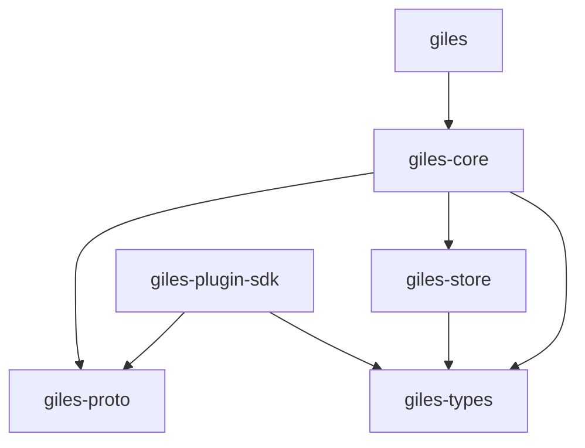

# Cargo Workspace

Cargo builds the whole repository. The root `Cargo.toml` is a virtual workspace (`resolver = "3"`)
whose members are `crates/*`. First-party plugins will live in `plugins/giles-<kind>-<name>`;
`"plugins/*"` is added to `members` in the same commit that creates the first one, because Cargo
rejects a glob over a directory that doesn't exist.

## Crates

| Crate              | Kind | Published | Contents                                                     |
| ------------------ | ---- | --------- | ------------------------------------------------------------ |
| `giles`            | bin  | no        | The daemon and its command-line interface                    |
| `giles-core`       | lib  | no        | Orchestration: agent loop, routing, sessions, scheduling     |
| `giles-types`      | lib  | yes       | Domain types and the `Provider`, `Channel`, `Toolset` traits |
| `giles-proto`      | lib  | yes       | Generated gRPC code for the plugin and admin protocols       |
| `giles-plugin-sdk` | lib  | yes       | Serves a trait implementation as an out-of-process plugin    |
| `giles-store`      | lib  | no        | SQLite and file storage under `GILES_HOME`                   |

Dependencies between them:

`giles-types` is the contract shared by the core and plugins, so it depends on no other Giles
crate. Plugins depend on `giles-plugin-sdk` (and through it `giles-types` and `giles-proto`), never
on `giles-core` or `giles-store`.

The three crates a third-party plugin author needs (`giles-types`, `giles-proto`,
`giles-plugin-sdk`) are publishable to crates.io; each carries symlinks to the repository's
`LICENSE-MIT` and `LICENSE-APACHE` so the files ship in the package. The other crates set
`publish = false`.

## Toolchain and package metadata

- The toolchain is pinned in `rust-toolchain.toml` (Rust 1.99.1, `minimal` profile plus `clippy` and
  `rustfmt`, and the `x86_64-unknown-linux-gnu` target); rustup picks it up automatically.
  `Cargo.lock` is committed.
- Every crate inherits `version`, `edition` (2024), `rust-version`, `authors`, `repository`, and
  `license` (`MIT OR Apache-2.0`) from `[workspace.package]`.

## Lints

Lints are set once in `[workspace.lints]` and each crate opts in with `[lints] workspace = true`.
`unsafe_code` is `deny`, an error everywhere. The rest are warnings locally and errors in CI
(`cargo clippy -- -D warnings`).

- Rust: `unsafe_code = "deny"`, `missing_docs = "warn"`.
- Clippy: `clippy::all`, plus `cloned_instead_of_copied` and `implicit_clone` (from `pedantic`), and
  `dbg_macro`, `todo`, `unimplemented`, `undocumented_unsafe_blocks` (from `restriction`).

Consequences for code:

- `missing_docs` applies to every target: each crate root, `build.rs`, `examples/*.rs`, and
  `tests/*.rs` needs a `//!` comment (integration tests may use `#![allow(missing_docs)]` instead),
  and public helpers in integration tests need doc comments. `#[cfg(test)]` modules are exempt.
- Generated protobuf code is included in a module marked
  `#[allow(missing_docs, clippy::all, clippy::pedantic)]`.
- Where `unsafe` is unavoidable, the module carries `#[allow(unsafe_code)]` and every `unsafe` block
  has a `// SAFETY:` comment.

## Dependency policy

- A third-party dependency used by two or more crates is declared once in
  `[workspace.dependencies]`, and each crate opts in with `<dep>.workspace = true`, adding the
  features it needs. The shared stack: `anyhow`, `async-trait`, `bytes`, `futures`, `jiff` (only
  `std`; crates add `serde` or time zone database features), `libc`, `prost`, `serde` (with
  `derive`), `serde_json`, `sha2`, `thiserror`, `tokio` (no features enabled), `toml`, `tonic`,
  `tracing`, `tracing-subscriber`.
- A dependency used by a single crate goes in that crate's own manifest.
- Internal crates are also listed in `[workspace.dependencies]` with both `path` and `version`, so
  the publishable crates resolve on crates.io.
- Libraries use `thiserror` for errors; `anyhow` is for the binary.
